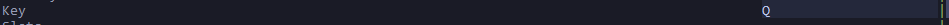
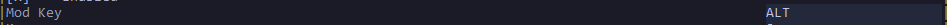
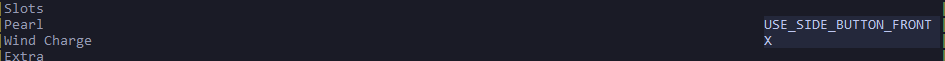

# How To Use Satella

## Config Format

Each macro's config is made up of 6 parts:

1. **Name**: identifies the macro (`Pearl Catch`, `Stun Slam`, Etc.)
2. **ID**: this is a important key in the code, do not touch.
3. **Enabled**: can be `true` or `false`, you guessed it? it enables and disables the macro :3
4. **Mod Key**: the modifying key (`alt`, `control`, `ctrl`, `shift`, `win`, `windows`).
5. **Key**: the key that must be pressed alongside the `Mod Key` to activate the macro (if mod key is empty the macro will be activated whenever the `key` is pressed)
6. **Slots**: it contains the hotkeys to the item's position in hotbar.

Example:

```json
"Pearl Catch": {
  "ID": 1,
  "Enabled": true,
  "Mod Key": "ALT",
  "Key": "Q",
  "Slots": {
    "Pearl": "MOUSE_SIDE_BUTTON_FRONT",
    "Wind Charge": "X"
  }
},
```

You may have noticed values like `MOUSE_SIDE_BUTTON_FRONT`, these refer to mouse side buttons:

| Value   | Meaning                  |
| ------- | ------------------------ |
| `MOUSE_SIDE_BUTTON_FRONT` | Mouse side button, front |
| `MOUSE_SIDE_BUTTON_BACK` | Mouse side button, back  |

> does this even need explaning?

Use these anywhere a slot expects a keybind that is bounded to a mouse side button.

### Customizable parts

You may have noticed some macros have an `extra` option in them.

```json
"Extra": {
  "Switch Back To Slot": "2"
}
```

and

```json
"Extra": {
  "Speed": "Medium"
}
```

the first one accepts a keybind key. if you don't want the option enabled make the field empty

the second accepts `Fast` `Medium` `Slow`. default is `Medium`

--- 

## Triggering Macros

Triggering macros are those that perform an action one time.

- Perl Catch
- Stun Slam
- Lunge Swap
- Breach Swap
- Single Anchor


## How to edit config from TUI

so, first of all, we still follow [this format](#config-format).

---

### Key



just input any letter, for example, if we input `X` (and the mod key is empty) when we press `X` the macro will  be activated.

### Mod Key



This has limited inputs... i think, anyways
this means you have to press both mod key button and key button to activate the macro, for example, if i put `ALT` in my mod key and put `Q` in my key, i have to press `ALT+Q` to activate the macro.

### Slots



This is the keys you have to press to go to each slot that has the given item in, for example, if i need to press `F` to go to my 9th slot which has my windcharge in it i put `F` inside the windcharge input.

### Pearl catch extras


This takes 3 inputs

`Fast` | `Medium` | `Slow`

Fast waits 1 tick before using wind charge

Medium does 2 tick

and Slow does 4 tick

### Stun slam extras


This determinds if the macro should switch to a slot after finishing the stun slam, you can give it a [key](#key)